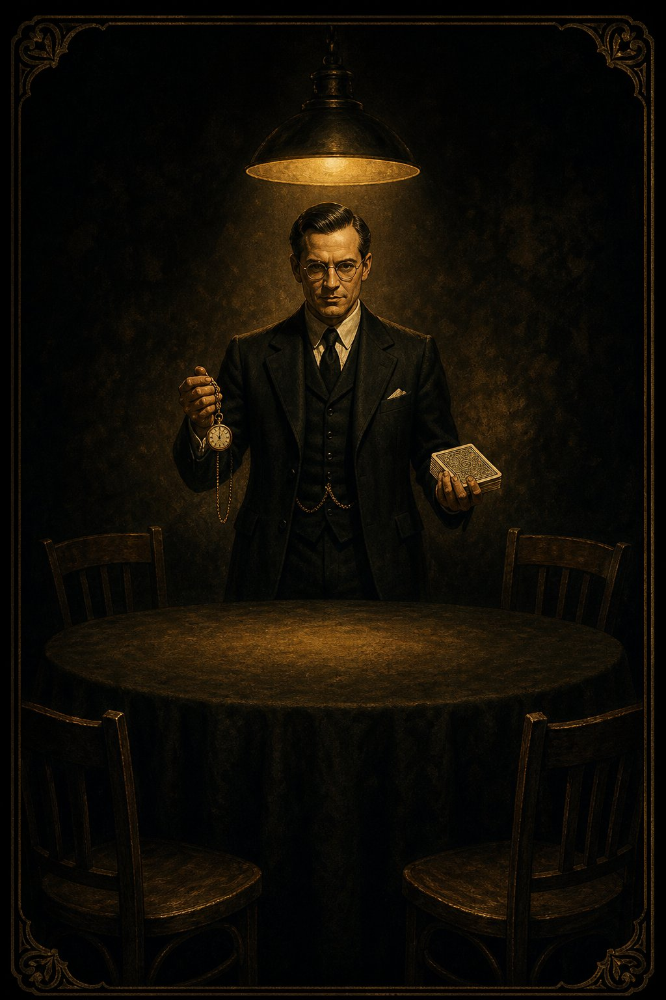
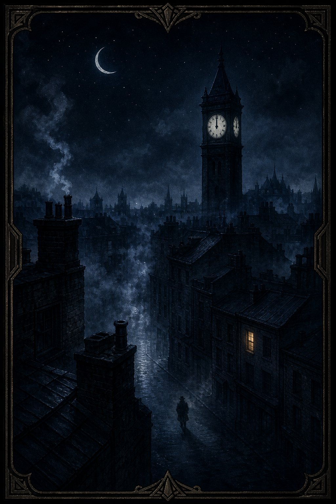
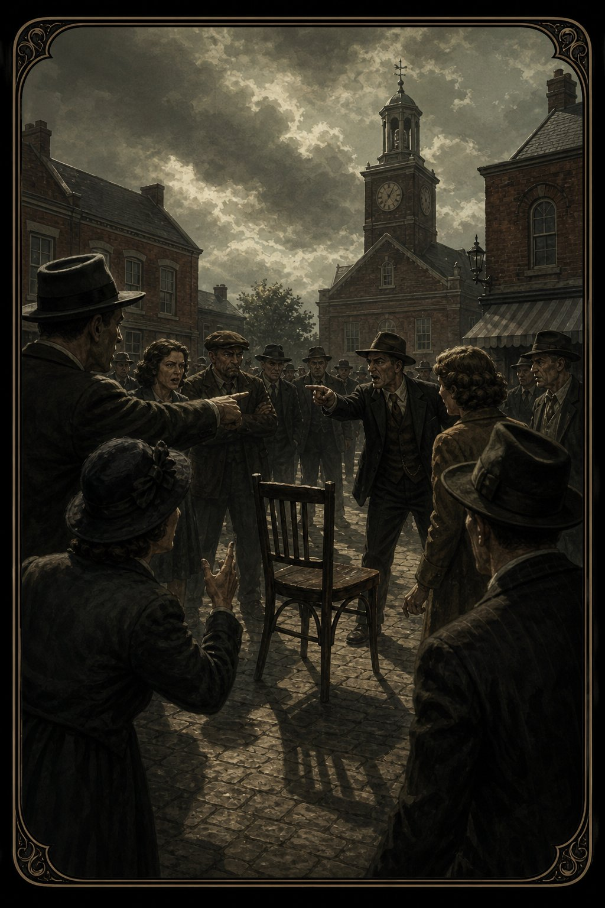

# Мафия: Локация — инструкция для ведущего

> **Ваша задача:** телефон-сервер в руках, порядок за столом и голос,
> который объявляет итоги. В обычной партии ведущий нейтрален и не играет.
>
> Партия на 10 человек занимает **25–40 минут**. Первая — дольше,
> потому что все читают роли.
>
> **С 1.11.0 есть третий сценарий:** ведущий играет сам, а недостающих
> игроков заменяют боты — см. §1.5. Это режим для двоих-троих,
> для тренировки и для проверки ролей, а не для соревновательной партии.

---

## 1. Подготовка (до прихода гостей)

### 1.1. Телефон

| Требование | Почему |
|---|---|
| Android, зарядка или павербанк | Вы держите сервер и экран всё время партии |
| Установленное приложение **«Мафия Offline»** | APK собирается из этого репозитория |
| Выключен «умный» режим энергосбережения | Иначе Android убьёт сервер при выключенном экране |
| Разрешение на уведомления | Постоянное уведомление держит сервер живым |

### 1.2. Состав

Минимум **6**, максимум **20** игроков. Меньше шести — город не может
выгнать мафию голосованием; больше двадцати — обсуждение распадается
на группы, и половина не успевает сказать ни слова.

Рекомендуемые составы (кнопки в приложении: 8, 10, 14, 18):

| Игроков | Мафия | Дон | Шантажист | Доктор | Комиссар | Телохранитель | Проститутка | Свидетель | Охотник | Маньяк |
|---|---|---|---|---|---|---|---|---|---|---|
| 6–8 | 1 | 1 | 0 | 1 | 1 | 0 | 0 | 0 | 0 | 0 |
| 9–12 | 2 | 1 | 0 | 1 | 1 | 0 | 1 | 0 | 0 | 0 |
| 13–16 | 3 | 1 | 1 | 1 | 1 | 1 | 1 | 0 | 0 | 1 |
| 17–20 | 4 | 1 | 1 | 1 | 1 | 1 | 1 | 1 | 1 | 1 |

Именно эти составы подставляют кнопки 8 / 10 / 14 / 18 в приложении —
менять можно любую строку, это подсказка, а не закон.

> **Маньяк — не для первой партии.** Он играет сам за себя и путает
> новичкам картину: город ждёт, что партия закончится с выбитой мафией,
> а она продолжается. Берите его, когда стол уже знает базовые правила.

> **Новые роли (1.12.0) — тоже не с первой партии.** Начинайте с базы
> (мафия, дон, доктор, комиссар), на второй партии добавьте проститутку
> и телохранителя, и только потом — свидетеля, охотника и шантажиста.
> Причина не в сложности правил, а в том, что новые роли дают городу
> много «бумажных» улик: свидетель, охотник и телохранитель вместе
> превращают первый круг в бухгалтерию, и обсуждать почти нечего.

> **Шантажист — мафия, но не стрелок.** В выборе жертвы он не участвует,
> зато считается мафией во всех подсчётах: и в «своих» на карточке,
> и в условии победы. Поэтому город не выигрывает, пока жив хоть один
> шантажист, а мафия побеждает, как только мафии становится столько же,
> сколько горожан. Практический совет: если все стрелки мертвы, а
> шантажист жив, партия почти наверняка закончится победой мафии —
> он лишает город голосов быстрее, чем город успевает его найти.

### 1.3. Переключатель «Открывать карту выбывшего»

На экране создания партии.

- **Выключено (по умолчанию) — классика.** Роль погибшего не раскрывается
  до конца партии. Город спорит, кого он потерял, и это главный источник
  интриги.
- **Включено — для новичков и коротких партий.** Все сразу видят роль
  выбывшего: проще объяснять, быстрее идёт игра, меньше споров «а кто
  был-то?».

Один раз попробуйте оба варианта — стол сам скажет, что ему ближе.

### 1.4. Остальные правила стола (с версии 1.2.0)

Там же, на экране создания партии, блок «Правила стола». Приложение
запоминает ваш выбор до следующей партии.

| Переключатель | По умолчанию | Что делает |
|---|---|---|
| **Первая ночь — знакомство** | выключено | В первую ночь никто не погибает. Ходит только комиссар. Включайте для новичков: никто не вылетает, не сказав ни слова |
| **Последнее слово и повторное голосование** | включено | Тот, кого выбрал стол, ещё не выбыл: 30 секунд говорит, потом все голосуют ещё раз — выгнать или оставить. Поровну — остаётся. Выключено — выбывает сразу. Убитым ночью слово не даётся |
| **Комиссар видит результат проверки** | включено | Ответ появляется у комиссара на экране сразу, как он выбрал игрока, — один раз за ночь; все проверки хранятся в «Моя роль». Выключено — результат знаете только вы |

Игроки видят эти правила у себя: кнопка «Правила» (книга) в лобби
и во время партии. Они же попадают в протокол партии первой строкой —
спор «мы так не договаривались» решается за десять секунд.

> **Про проверку комиссара.** В ТЗ результат знает только ведущий
> (FR-5.3), и вы шепчете его комиссару или показываете жестом. На практике
> именно в этот момент роль комиссара и утекает: к нему подошли — значит,
> он кто-то. Поэтому по умолчанию ответ приходит ему на телефон:
> **ночью — прямо на экран, сразу как он выбрал игрока** (с версии 1.3.0),
> а с рассветом остаётся только внутри «Моя роль». Без всплывающих строк,
> звука и вибрации: ночью комиссар и так смотрит в экран, а днём на столе
> не должно быть ничего, что есть только у него. Хотите строго по ТЗ —
> выключите переключатель.

---

### 1.5. Боты и соло-режим (с версии 1.11.0)

В лобби, над QR-кодом, есть панель **«Не хватает игроков?»**:

| Кнопка | Что делает |
|---|---|
| **Играть одному** | добавляет локального игрока «Ведущий» и добивает стол ботами |
| **Ведущий тоже играет** | то же, когда по сети уже зашли живые люди |
| **+1 бот** | добавить одного бота вручную |
| **Добрать до 6** | довести число игроков до минимального |

Если нажать «Раздать роли» с неполным столом, недостающие до шести места
займут боты автоматически — партия не сорвётся из-за того, что двое
опоздали.

**Как играть одному.** Создайте игру → «Играть одному» → «Раздать роли».
Вы увидите закрытую карту своей роли: остальные её не увидят, но и вы
не увидите свою, пока не нажмёте «Я один — показать роль». Дальше ваша
роль работает как у любого игрока: ночью на экране появится панель
с целями, днём — голосование и «Выгнать / Оставить».

**Что важно знать:**

* День в соло-партии короче — 20 секунд вместо расчёта по 45 секунд
  на игрока: боты не будут ждать вас минуту.
* Боты ходят через 2–5 секунд. Если вы уже сходили, они не тянут время.
* Боты знают только то, что знал бы человек с их ролью. Комиссар помнит
  свои проверки, мафия не стреляет по своим, доктор не лечит себя.
* Днём боты пишут короткие реплики — до трёх за день.
* Роли ботов не открываются в списке игроков и в публичных данных.
* **Честность.** В режиме «Играть одному» вы технически можете открыть
  список ролей. Это тренировка и игра «против движка». Для партии
  с живыми людьми ведущий играет на отдельном устройстве либо остаётся
  судьёй. Если хотите строгий режим — не создавайте стол «Играть одному»,
  а добавьте ботов к живым игрокам.

---

## 2. Начало партии

1. **Создайте игру.** Название можно любое — оно видно игрокам.
2. **Покажите QR-код.** Поднимите телефон, чтобы было видно всем.
   Первым открыт **«Один код»** (с версии 1.4.0) — в нём и ваша сеть
   Wi-Fi, и вход в игру:
   * у кого стоит приложение «Мафия» — «Я игрок» → «Сканировать QR»,
     и человек за столом: телефон сам подключится к сети и войдёт;
   * у кого приложения нет — наводят обычную камеру: код подключит
     их к Wi-Fi. Затем переключите вкладку **«Для браузера»** и покажите
     второй код — он откроет игру.

   Один код на всё для браузера сделать нельзя: камера по одному коду
   делает одно действие. Подробно — `CHANGELOG_1.4.0.md`, §1.
   Чья-то камера первый код не читает — «Изменить» → выключите
   «Единый код», останется обычный код сети.
   Продиктуйте адрес вслух — у кого-то нет камеры или она не работает.
3. **Дождитесь, пока все зайдут.** В списке должно быть столько же
   имён, сколько людей. Проверьте по головам: частая ситуация — человек
   зашёл дважды с телефона и планшета.
4. **Переименуйте, если нужно.** Только вы можете менять имена. Введите
   нормальные имена сразу: потом это будут путать.
5. **Раздайте роли.** Нажмите «Раздать роли».

### Что происходит после раздачи

Игроки по очереди читают свои карточки и нажимают «Понятно». Ночь
**не начнётся, пока не нажали все** — так никто не останется в роли,
которую не успел прочитать.

Если кто-то не нажимает — вы видите его имя в подсказке. Подойдите
и помогите. Не начинайте «на живых»: этот человек просто не будет
знать, что делать, и сорвёт вам первый круг.

---

## 3. Ночь

1. Объявите вслух: **«Город засыпает»**.
2. Нажмите «Начать ночь». У активных игроков на экранах появятся цели,
   у остальных — «Спите».
3. Подсказка сверху показывает, **чьих ходов вы ждёте**. Если ждёте
   двоих, а прошла минута — тихо подойдите к ним, не объявляйте вслух:
   так вы выдадите их роли.
4. Когда все ходы собраны, нажмите «Завершить ночь» и объявите итог.

### Ночь знакомства

Если правило включено, первая ночь идёт иначе:

1. Скажите: **«Город засыпает. Просыпается мафия — посмотрите друг на
   друга»**. Дайте им десять секунд и «усыпите» обратно. Приложение этого
   не делает и не должно: на экранах у мафии то же «Спите», что у всех, —
   особая надпись выдала бы роль соседу. Союзники перечислены у каждого
   мафиози на карте роли.
2. Комиссар делает проверку на телефоне и сразу видит ответ: проститутка
   в ночь знакомства спит. Подсказка сверху покажет, когда его ход получен.
3. Нажмите «Завершить ночь». В сводке будет «Ночь знакомства: все живы»,
   готовая фраза для объявления — там же.

Доктор, проститутка, телохранитель, свидетель, охотник, шантажист
и маньяк в эту ночь не ходят. Лечение и щит не тратятся:
во вторую ночь доктор может лечить кого угодно. Таймер этой ночи короче
обычного — ждать нужно одного человека, а не шестерых.

### Порядок разрешения ходов

Приложение считает сам, но вам как ведущему полезно знать порядок —
на случай спора:

1. **Проститутка** блокирует — её цель пропускает ход.
2. **Шантажист** пугает — цель **не** лишается хода, но весь следующий
   день не голосует.
3. **Доктор** лечит — защита от **мафии и маньяка** одновременно.
4. **Телохранитель** прикрывает — удар в прикрытого забирает он сам.
   Щит срабатывает **раньше** доктора.
5. **Мафия** стреляет. При разногласии решает дон. Шантажист в выборе
   жертвы не участвует — он не стрелок.
6. **Маньяк** стреляет в свою цель.
7. **Свидетель** смотрит, выходил ли его объект из дома.
8. **Охотник** ставит метку на следующую ночь.
9. **Комиссар** проверяет.

Особые случаи, о которых вас спросят:

| Ситуация | Результат |
|---|---|
| Доктор лечил цель мафии | Жертва жива. Если маньяк бил в того же — тоже жива |
| Проститутка заблокировала мафию | Никто не убит |
| Проститутка заблокировала дона | Если других мафиози нет — выстрела не будет |
| Доктор пытался лечить себя | **Лечение не срабатывает** (классическое правило) |
| Доктор лечил этого игрока прошлой ночью | **Лечение не срабатывает** |
| Комиссара заблокировала проститутка | Он увидит «Проверка не состоялась». Кто его цель на самом деле, приложение ему не скажет |
| Комиссара убили этой же ночью | Проверку он сделал и ответ увидел ещё ночью (но рассказать уже не вправе) |
| Комиссар проверил дона или маньяка | Ответ «не мафия» — так и должно быть |
| Комиссар выбрал, а ответа у него нет | Проститутка ещё не сходила — приложение ждёт её хода. Ответ придёт в момент её выбора или когда вы завершите ночь, но всегда до рассвета |
| Комиссар хочет проверить второго или передумал | Нельзя: одна проверка за ночь, выбор окончательный |
| Мафия и маньяк стреляли в прикрытого телохранителем | Погибает **телохранитель**, прикрытый жив. Щит держит оба удара сразу — это не «одна жизнь», а «эту ночь он не умирает» |
| Стреляли в самого телохранителя | Щит не спасает: он прикрывает другого, а не себя. Телохранитель погибает |
| Телохранитель прикрывал того же игрока прошлой ночью | Прикрытие **не срабатывает** (как у доктора). Правило не даёт поставить щит на одного и того же навсегда |
| Шантажист запугал доктора | Доктор лечит как обычно. Шантаж отнимает голос, а не ночной ход |
| Шантажист запугал мафию | Невозможно: цель шантажа — только горожанин. Ход отклонит и сервер |
| Запуганный не может голосовать | Кнопки голосования ему не показываются, а его голос, если он успел нажать до шантажа, не считается |
| Свидетель смотрел за мирным жителем | Ответ «не выходил» — это тоже информация. Мирный житель ночью спит |
| Свидетель смотрел за убитым этой же ночью | Наблюдение состоялось: он видел, выходил ли тот. Ответ останется у свидетеля |
| Свидетеля убили этой же ночью | Он узнал ответ (если объект успел сходить) и уже никому его не расскажет. Живым его не показать |
| Охотник поставил метку и погиб в ту же ночь | Метка **не срабатывает**: она действует со следующей ночи. Забирает только прошлая, «созревшая» метка |
| Охотника выгнали голосованием | Отмеченный погибает **вместе с ним**. Изгнание — такая же смерть для метки |
| Охотник отметил уже мёртвого или себя | Невозможно: список целей ограничен живыми и не им самим |

> **Почему комиссар иногда ждёт.** Проверку отменяет только блокировка
> проститутки. Если показать ответ, а потом выяснить, что комиссар был
> заблокирован, отнять увиденное уже нельзя. Поэтому, пока проститутка
> жива и не сходила, ответ придерживается. За столом без проститутки
> (и в ночь знакомства) ответ приходит мгновенно. Побочный эффект, о
> котором стоит знать: по задержке комиссар понимает, что проститутка
> ещё жива.

---

## 4. Утро и день

1. Объявите: **«Город просыпается»** и назовите погибших.
   В приложении уже есть готовая фраза — читайте её.
2. **При открытой карте** назовите и роль выбывшего. При закрытой —
   только имя: роль останется тайной до конца партии.
3. Запустите день. Таймер считает сам, но вы можете продлить или
   поставить паузу, если обсуждение живое.

> **Правило, которое вы обязаны держать:** выбывшие не подсказывают
> живым. Ни словами, ни жестами. Это единственное правило, за нарушение
> которого я бы удалял из-за стола, — мёртвым нечего терять, и они
> ломают партию быстрее любого читера.

---

## 5. Голосование

1. Нажмите «Начать голосование».
2. Все живые выбирают. Подсказка показывает, кто ещё не проголосовал.
3. **Равенство** — приложение предложит второй тур между лидерами.
4. Второе равенство — никто не выбывает.
5. **Последнее слово.** В сводке голосования кнопка теперь называется
   «Последнее слово: Имя» — игрок **ещё не выбыл**. Приложение запускает
   таймер на 30 секунд: на вашем экране — «Последнее слово: Имя», у игроков
   то же самое, у говорящего — «Ваше последнее слово». Договорил раньше —
   нажмите «Слово сказано → голосовать ещё раз». Паузу и «+30 с»
   использовать можно, как в любой фазе.
6. **Повторное голосование.** Запускается само после слова. У всех живых,
   кроме обвиняемого, две кнопки: «Выгнать» и «Оставить в игре». Вы видите,
   кто ещё не нажал; закрыть голосование досрочно можно как обычно.
7. **Решение.** В сводке — два столбика: «Выгнать» и «Оставить» (нажмите
   на столбик, чтобы увидеть, кто так голосовал) и готовый вывод:
   - «выгнать» больше — **выбывает**;
   - «оставить» больше или **поровну** — **остаётся**;
   - не нажавшие ничего не считаются ни туда, ни сюда.

   Основная кнопка подтверждает решение стола. Вторая — «Всё же выгнать»
   или «Оставить в игре» — на случай, если за столом договорились иначе:
   последнее слово, как и в любом голосовании, за вами.
8. После решения сразу ночь. Если игрока оставили, в этот день не выбывает
   никто — возвращаться к обсуждению и голосовать за другого нельзя.

> **Последнего мафиози тоже выслушивают.** Слово и повторное голосование
> идут всегда, даже если изгнание закончило бы партию. Иначе стол узнавал
> бы роль по самому факту: «слова не дали — значит, это была мафия».
> Финал наступает после повторного голосования, если игрока выгнали.

> **Чем это отличается от второго тура.** Второй тур — при ничьей между
> несколькими игроками, стол выбирает одного. Повторное голосование —
> про одного человека. Возможна цепочка: голосование → ничья → второй
> тур → последнее слово → повторное голосование.

> Если правило выключено — выбывает сразу тот, кого выбрало голосование,
> и наступает ночь, а слово (или его отсутствие) на вашей совести.
> Дольше минуты не давайте: оно почти всегда превращается в пересказ
> всей партии и съедает темп.

| Ситуация | Что делает приложение |
|---|---|
| Телефон ведущего перезапустился во время повторного голосования | Партия восстановится на том же шаге: кто обвиняемый и кто как проголосовал — сохранено. Таймер на паузе |
| У игрока в браузере старая версия страницы | Он увидит обычное голосование с одним именем: «Проголосовать» значит «выгнать», «Воздержаться» — «оставить». Попросите обновить страницу |

---

## 6. Конец партии

Приложение само определит победителя и покажет экран финала.

| Итог | Условие |
|---|---|
| Город | Нет ни мафии, ни маньяка |
| Мафия | Мафии столько же, сколько горожан, или больше |
| Маньяк | Остался единственным живым |
| Ничья | Все погибли одновременно |

**После финала:** покажите протокол (История → «Поделиться протоколом»).
Он снимает 90% споров «а я же говорил». Там видно все роли и всю
хронологию.

---

## 7. Чего не делать

| Не делайте | Почему |
|---|---|
| Не комментируйте ночные ходы вслух | «О, интересный выбор» — и вы выдали роль |
| Не подсказывайте жестами | За столом это видят все, кроме вас |
| Не начинайте партию с нечитанными ролями | Человек выпадет из игры в первую же ночь |
| Не играйте сами в живой партии | Ведущий, играющий за себя, — это конфликт интересов: он видит роли. Для игры «против движка» есть отдельный соло-режим (§1.5), там это честно и оговорено |
| Не растягивайте день больше 10 минут | После этого обсуждение идёт по кругу, и город голосует наугад |

---

## 8. Если что-то пошло не так

| Ситуация | Действие |
|---|---|
| Игрок вылетел (разрядился телефон) | Скажите открыть адрес и ввести то же имя — вернётся в свой слот |
| Кто-то зашёл под чужим именем | Вы видите это в списке; переименуйте или попросите выйти |
| Двое зашли с одного телефона | Так нельзя: слот один. Нужны два устройства |
| Игрок увидел чужую роль | Увы, партию лучше перезапустить: информация уже утекла |
| Приложение зависло | Не закрывайте — дождитесь переподключения. Все данные хранятся на вашем телефоне |
| Нужно прервать партию | Меню → завершить игру. Прогресс сохранится в истории |

---

## 9. Чек-лист перед первой партией

- [ ] Телефон заряжен, энергосбережение выключено
- [ ] Уведомления разрешены
- [ ] Скажите вслух правила победы — их путают чаще всего
- [ ] Объясните: выбывшие не подсказывают
- [ ] Покажите, где кнопка «Моя роль» (перечитать карточку можно всегда)
- [ ] Покажите кнопку «Правила» — там правила именно этого стола
- [ ] Про комиссара заранее, при всех: «ответ на проверку появится на
      экране сразу, одна проверка за ночь; потом он лежит в „Моя роль“»
      (говорите это всему столу до раздачи, а не ему лично)
- [ ] Про голосование: «кого выбрали — ещё не выбыл: последнее слово,
      потом голосуем ещё раз, поровну — остаётся»
- [ ] Проверьте, что все нажали «Понятно» до старта ночи
- [ ] Если играете с ботами: посмотрите на панель «Не хватает игроков?»
      и решите заранее — «Играть одному» или боты добираются к живым.
      Ботов не нужно ждать на ночной ход: они ходят сами за 2–5 секунд
