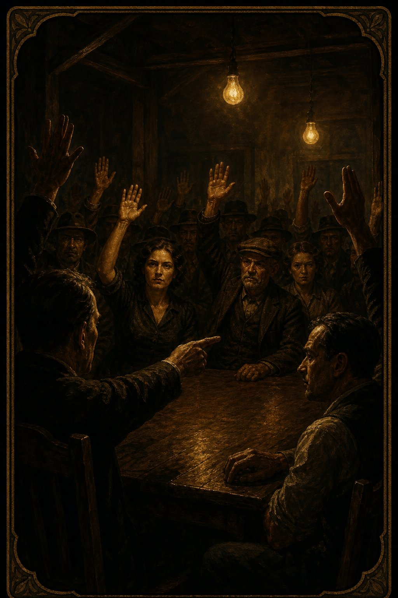

# Мафия: Локация — инструкция для ведущего

> **Ваша задача:** телефон-сервер в руках, порядок за столом и голос,
> который объявляет итоги. Играть вы не можете — ведущий нейтрален.
>
> Партия на 10 человек занимает **25–40 минут**. Первая — дольше,
> потому что все читают роли.

---

## 1. Подготовка (до прихода гостей)

### 1.1. Телефон

| Требование | Почему |
|---|---|
| Android, зарядка или павербанк | Вы держите сервер и экран всё время партии |
| Установленное приложение **«Мафия Offline»** | APK собирается из этого репозитория |
| Выключен «умный» режим энергосбережения | Иначе Android убьёт сервер при выключенном экране |
| Разрешение на уведомления | Постоянное уведомление держит сервер живым |

### 1.2. Состав

Минимум **6**, максимум **20** игроков. Меньше шести — город не может
выгнать мафию голосованием; больше двадцати — обсуждение распадается
на группы, и половина не успевает сказать ни слова.

Рекомендуемые составы (кнопки в приложении: 8, 10, 14, 18):

| Игроков | Мафия | Дон | Доктор | Комиссар | Проститутка | Маньяк |
|---|---|---|---|---|---|---|
| 6–8 | 1 | 1 | 1 | 1 | 0 | 0 |
| 9–12 | 2 | 1 | 1 | 1 | 1 | 0 |
| 13–16 | 3 | 1 | 1 | 1 | 1 | 0–1 |
| 17–20 | 3–4 | 1 | 1 | 1 | 1 | 0–1 |

> **Маньяк — не для первой партии.** Он играет сам за себя и путает
> новичкам картину: город ждёт, что партия закончится с выбитой мафией,
> а она продолжается. Берите его, когда стол уже знает базовые правила.

### 1.3. Переключатель «Открывать карту выбывшего»

На экране создания партии.

- **Выключено (по умолчанию) — классика.** Роль погибшего не раскрывается
  до конца партии. Город спорит, кого он потерял, и это главный источник
  интриги.
- **Включено — для новичков и коротких партий.** Все сразу видят роль
  выбывшего: проще объяснять, быстрее идёт игра, меньше споров «а кто
  был-то?».

Один раз попробуйте оба варианта — стол сам скажет, что ему ближе.

---

## 2. Начало партии

1. **Создайте игру.** Название можно любое — оно видно игрокам.
2. **Покажите QR-код.** Поднимите телефон, чтобы было видно всем.
   Продиктуйте адрес вслух — у кого-то нет камеры или она не работает.
3. **Дождитесь, пока все зайдут.** В списке должно быть столько же
   имён, сколько людей. Проверьте по головам: частая ситуация — человек
   зашёл дважды с телефона и планшета.
4. **Переименуйте, если нужно.** Только вы можете менять имена. Введите
   нормальные имена сразу: потом это будут путать.
5. **Раздайте роли.** Нажмите «Раздать роли».

### Что происходит после раздачи

Игроки по очереди читают свои карточки и нажимают «Понятно». Ночь
**не начнётся, пока не нажали все** — так никто не останется в роли,
которую не успел прочитать.

Если кто-то не нажимает — вы видите его имя в подсказке. Подойдите
и помогите. Не начинайте «на живых»: этот человек просто не будет
знать, что делать, и сорвёт вам первый круг.

---

## 3. Ночь

1. Объявите вслух: **«Город засыпает»**.
2. Нажмите «Начать ночь». У активных игроков на экранах появятся цели,
   у остальных — «Спите».
3. Подсказка сверху показывает, **чьих ходов вы ждёте**. Если ждёте
   двоих, а прошла минута — тихо подойдите к ним, не объявляйте вслух:
   так вы выдадите их роли.
4. Когда все ходы собраны, нажмите «Завершить ночь» и объявите итог.

### Порядок разрешения ходов

Приложение считает сам, но вам как ведущему полезно знать порядок —
на случай спора:

1. **Проститутка** блокирует — её цель пропускает ход.
2. **Доктор** лечит — защита от **мафии и маньяка** одновременно.
3. **Мафия** стреляет. При разногласии решает дон.
4. **Маньяк** стреляет в свою цель.
5. **Комиссар** проверяет.

Особые случаи, о которых вас спросят:

| Ситуация | Результат |
|---|---|
| Доктор лечил цель мафии | Жертва жива. Если маньяк бил в того же — тоже жива |
| Проститутка заблокировала мафию | Никто не убит |
| Проститутка заблокировала дона | Если других мафиози нет — выстрела не будет |
| Доктор пытался лечить себя | **Лечение не срабатывает** (классическое правило) |
| Доктор лечил этого игрока прошлой ночью | **Лечение не срабатывает** |

---

## 4. Утро и день

1. Объявите: **«Город просыпается»** и назовите погибших.
   В приложении уже есть готовая фраза — читайте её.
2. **При открытой карте** назовите и роль выбывшего. При закрытой —
   только имя: роль останется тайной до конца партии.
3. Запустите день. Таймер считает сам, но вы можете продлить или
   поставить паузу, если обсуждение живое.

> **Правило, которое вы обязаны держать:** выбывшие не подсказывают
> живым. Ни словами, ни жестами. Это единственное правило, за нарушение
> которого я бы удалял из-за стола, — мёртвым нечего терять, и они
> ломают партию быстрее любого читера.

---

## 5. Голосование

1. Нажмите «Начать голосование».
2. Все живые выбирают. Подсказка показывает, кто ещё не проголосовал.
3. **Равенство** — приложение предложит второй тур между лидерами.
4. Второе равенство — никто не выбывает.
5. Выбывший называет последнее слово (по желанию, 30 секунд).

> Не давайте «последнее слово» длиннее минуты. Оно почти всегда
> превращается в пересказ всей партии и съедает темп.

---

## 6. Конец партии

Приложение само определит победителя и покажет экран финала.

| Итог | Условие |
|---|---|
| Город | Нет ни мафии, ни маньяка |
| Мафия | Мафии столько же, сколько горожан, или больше |
| Маньяк | Остался единственным живым |
| Ничья | Все погибли одновременно |

**После финала:** покажите протокол (История → «Поделиться протоколом»).
Он снимает 90% споров «а я же говорил». Там видно все роли и всю
хронологию.

---

## 7. Чего не делать

| Не делайте | Почему |
|---|---|
| Не комментируйте ночные ходы вслух | «О, интересный выбор» — и вы выдали роль |
| Не подсказывайте жестами | За столом это видят все, кроме вас |
| Не начинайте партию с нечитанными ролями | Человек выпадет из игры в первую же ночь |
| Не играйте сами | Ведущий, играющий за себя, — это не мафия, это конфликт интересов |
| Не растягивайте день больше 10 минут | После этого обсуждение идёт по кругу, и город голосует наугад |

---

## 8. Если что-то пошло не так

| Ситуация | Действие |
|---|---|
| Игрок вылетел (разрядился телефон) | Скажите открыть адрес и ввести то же имя — вернётся в свой слот |
| Кто-то зашёл под чужим именем | Вы видите это в списке; переименуйте или попросите выйти |
| Двое зашли с одного телефона | Так нельзя: слот один. Нужны два устройства |
| Игрок увидел чужую роль | Увы, партию лучше перезапустить: информация уже утекла |
| Приложение зависло | Не закрывайте — дождитесь переподключения. Все данные хранятся на вашем телефоне |
| Нужно прервать партию | Меню → завершить игру. Прогресс сохранится в истории |

---

## 9. Чек-лист перед первой партией

- [ ] Телефон заряжен, энергосбережение выключено
- [ ] Уведомления разрешены
- [ ] Скажите вслух правила победы — их путают чаще всего
- [ ] Объясните: выбывшие не подсказывают
- [ ] Покажите, где кнопка «Моя роль» (перечитать карточку можно всегда)
- [ ] Проверьте, что все нажали «Понятно» до старта ночи
