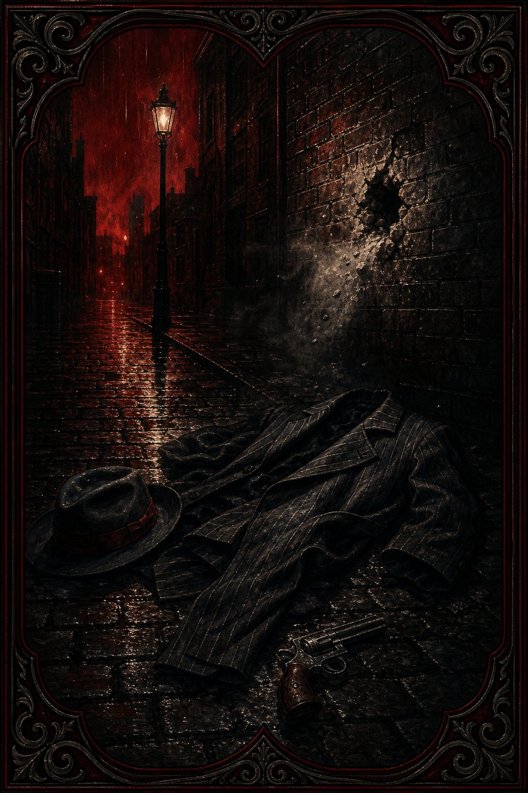
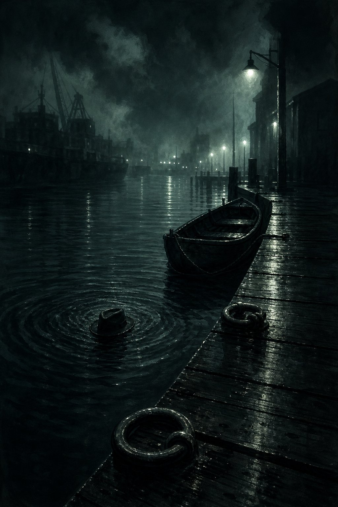
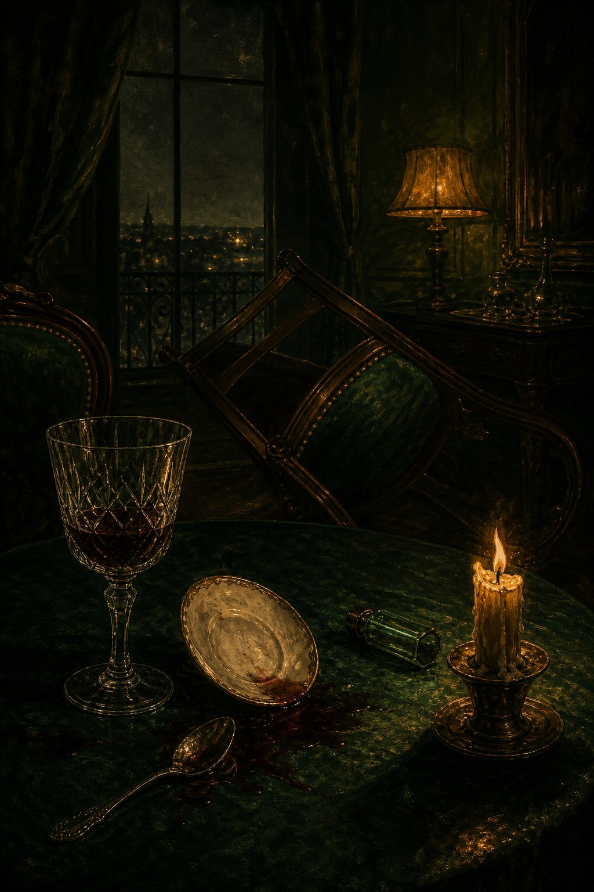
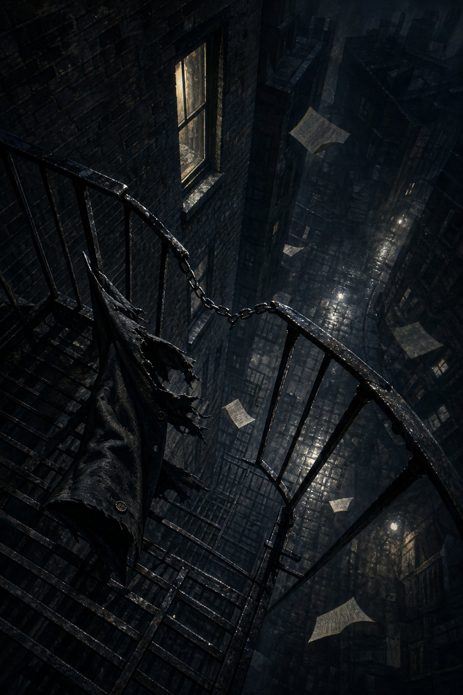
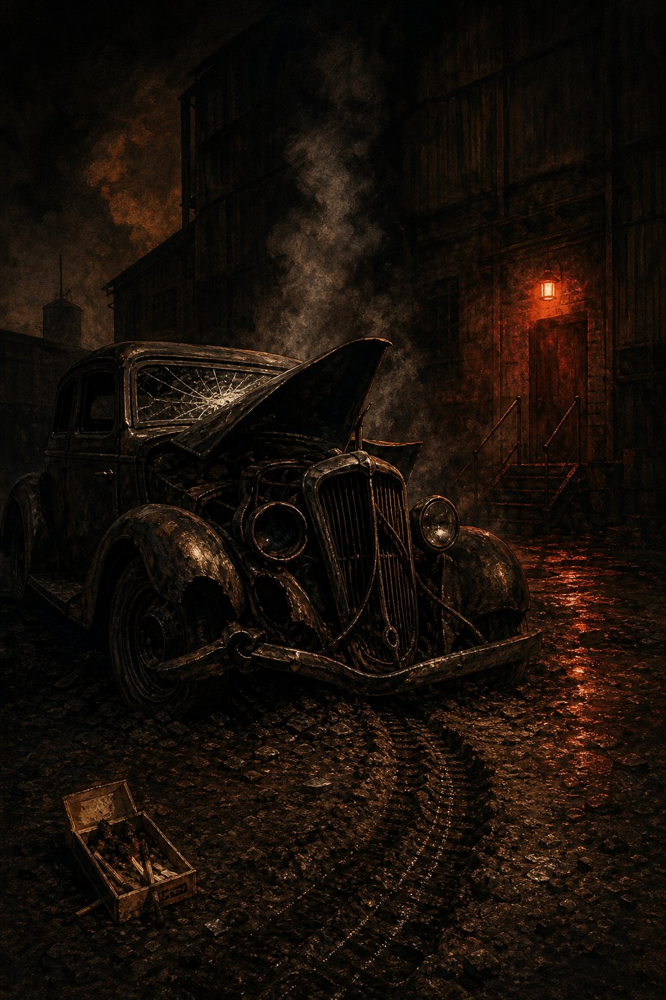
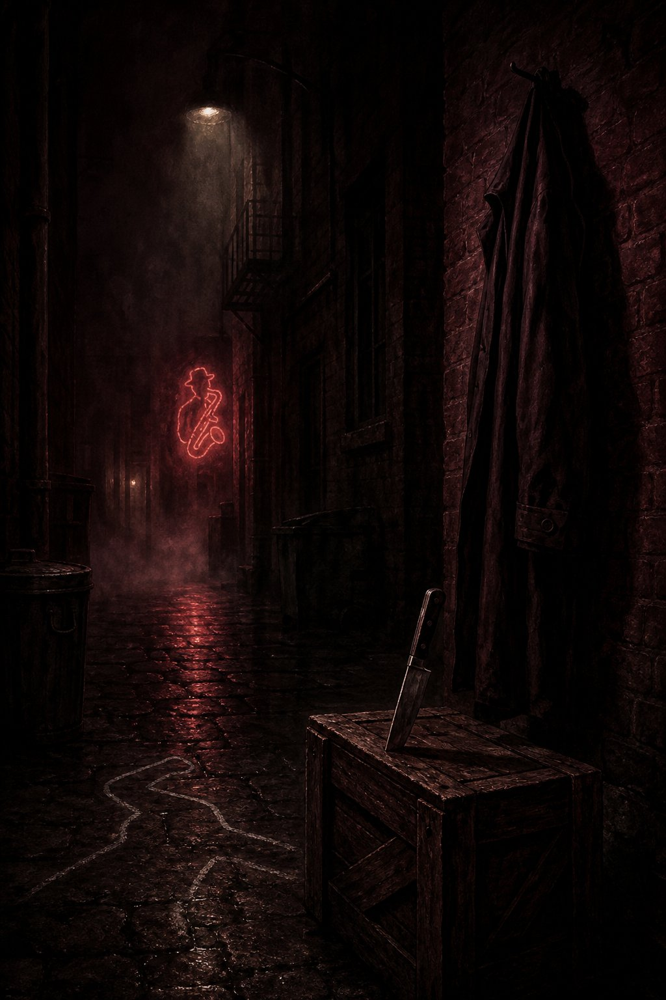
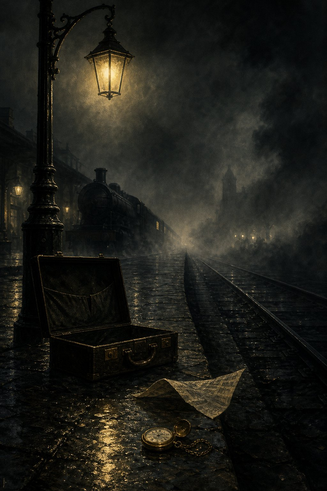
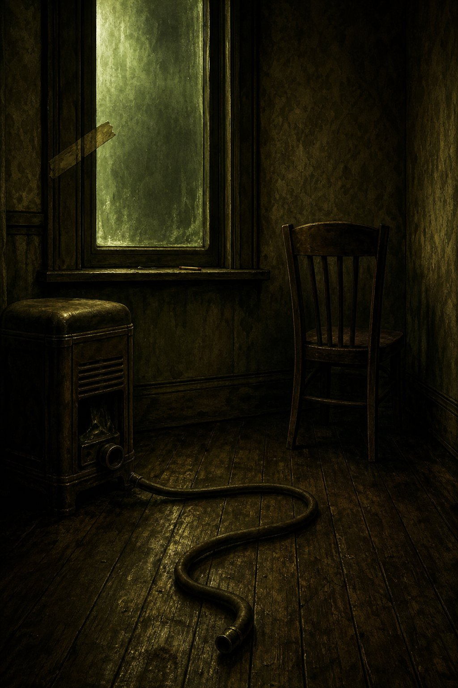

# Десять злодеяний мафии

> Колода для ведущего: **как именно** погиб игрок. Правила не меняются,
> меняется только фраза, которую вы читаете вслух, и строка в протоколе.
>
> «Ночь 1: погиб Вася» — это запись в логе.
> «Ночь 1: Вася — отравлен за ужином» — это сцена, которую обсуждают.

Все десять карточек — в `assets/instructions/crimes/` (нуар, золотая рамка,
как у остальных карт проекта).

---

## Как пользоваться

1. Ночь закончилась, приложение показало погибших.
2. Возьмите карточку злодеяния — вслепую, из колоды, или выберите по вкусу.
3. Прочитайте фразу вслух и покажите картинку, если играете с проектором
   или планшетом в центре стола.
4. Скажите, кого это касается. Способ **не подсказывает роль** убийцы:
   и мафия, и маньяк могут «утопить» или «отравить».

> **Важно:** способ смерти — это атмосфера, а не информация. Если вы
> читаете «отравлен за ужином», игроки не должны решить, что это точно
> мафия, а не маньяк. Иначе карточки начнут ломать баланс.

---

## 1. Огнестрел

**Фраза:** «снят выстрелом в переулке».

**Что сказать за столом:** дождь, фонарь, гильза на брусчатке. Такая смерть
не оставляет вопросов «как», только «кто».

**Когда уместно:** классика для первой ночи. Работает без объяснений.

---

## 2. Удушение

**Фраза:** «задушен в подсобке».

**Что сказать за столом:** тихая смерть, без крови. Хорошо идёт в партиях,
где уже были выстрелы: контраст делает ночь тревожнее.

**Особенность:** карточки нет. Сцена физически неудобна для иллюстрации,
и это тот случай, когда лучше текст без картинки, чем натурализм.

---

## 3. Утопление

**Фраза:** «утоплен в канале».

**Что сказать за столом:** шляпа на чёрной воде, круги расходятся. Тело
не нашли — есть только догадка.

**Когда уместно:** когда город потерял игрока, которого все считали
осторожным.

---

## 4. Яд

**Фраза:** «отравлен за ужином».

**Что сказать за столом:** бокал, опрокинутая ложка, свеча догорела.
Смерть за столом — самая «светская» и самая неприятная.

**Когда уместно:** отлично работает на второй-третьей ночи, когда за столом
уже есть подозреваемые, которых все считали друзьями.

---

## 5. Падение

**Фраза:** «сорвался с пожарной лестницы».

**Что сказать за столом:** порванный рукав на перилах, бумаги разлетелись.
Можно спорить, сам он упал или помогли.

**Когда уместно:** когда хочется дать городу ложную зацепку —
«а может, он сам?».

---

## 6. Взрыв

**Фраза:** «погиб при взрыве автомобиля».

**Что сказать за столом:** дым, искореженный капот, красный фонарь вдали.
Самая громкая смерть — хорошо для ночи, после которой город злится.

**Когда уместно:** когда погиб игрок, вокруг которого была интрига:
взрыв запоминают.

---

## 7. Нож

**Фраза:** «найден с ножом в переулке».

**Что сказать за столом:** нож в ящике, пальто на гвозде, мелом обведён
силуэт. Личная смерть — её обсуждают громче остальных.

**Когда уместно:** середина партии, когда страсти уже накалились.

---

## 8. Поезд

**Фраза:** «не дождался поезда на платформе».

**Что сказать за столом:** чемодан открыт, часы лежат на камне, туман съел
рельсы. Человек собирался уехать — и не уехал.

**Когда уместно:** когда погиб игрок, которого подозревали в желании
«выйти из игры».

---

## 9. Газ

**Фраза:** «задохнулся от газа в квартире».

**Что сказать за столом:** шланг снят, окно заклеено, спичка на подоконнике.
Самая тихая и самая страшная — без крика, без свидетелей.

**Когда уместно:** для опытного стола, который уже не вздрагивает
от выстрелов.

---

## 10. Электричество

**Фраза:** «убит током в подвале».

**Что сказать за столом:** рубильник опущен, лужа воды, искрит медный провод.
Техничная смерть — хороша для города, где есть инженеры и электрики.

**Особенность:** карточки нет — не хватило лимита генерации. Текст
используется наравне с остальными.

---

## Что это даёт партии

| Без карточек | С карточками |
|---|---|
| «Погиб Вася» — факт | «Вася отравлен за ужином» — сцена |
| Обсуждение начинается с «ну и кто?» | Обсуждение начинается с деталей |
| Протокол читают только спорщики | Протокол интересно перечитывать |

Чего карточки **не** делают: не меняют правила, не дают информации
о роли убийцы, не влияют на голосование.

---

## Чего не хватает

- **Удушение** и **электричество** — без иллюстраций. Первая не проходит
  генерацию (сцена недопустимая), вторая не влезла в лимит.
- В приложении пока **нет выбора злодеяния**: оно живёт в тексте ведущего.
  Следующий шаг — рулетка на экране ведущего, чтобы фраза появлялась
  в протоколе сама. Это полдня работы: тот же `CrimeDeck`, поле в `GameEvent`
  и одна кнопка.
