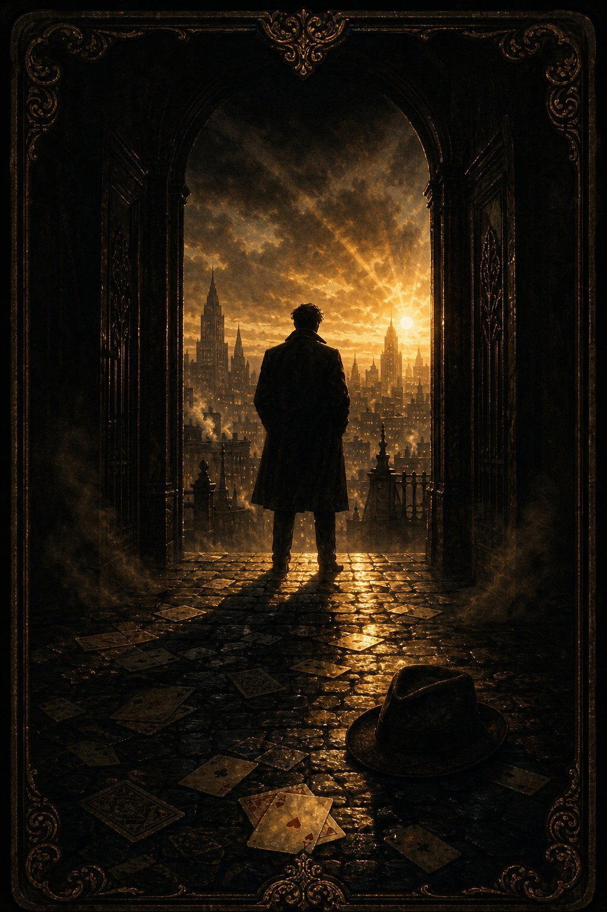
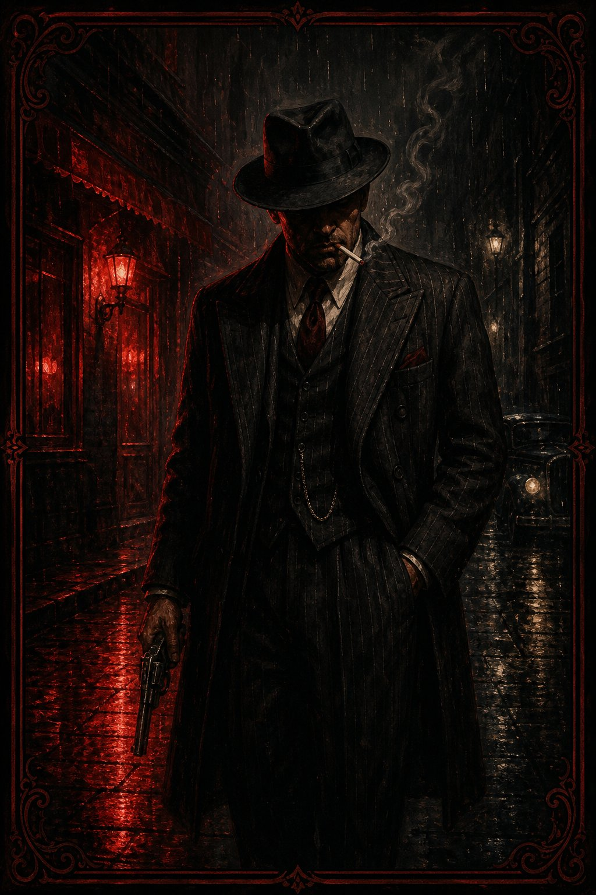
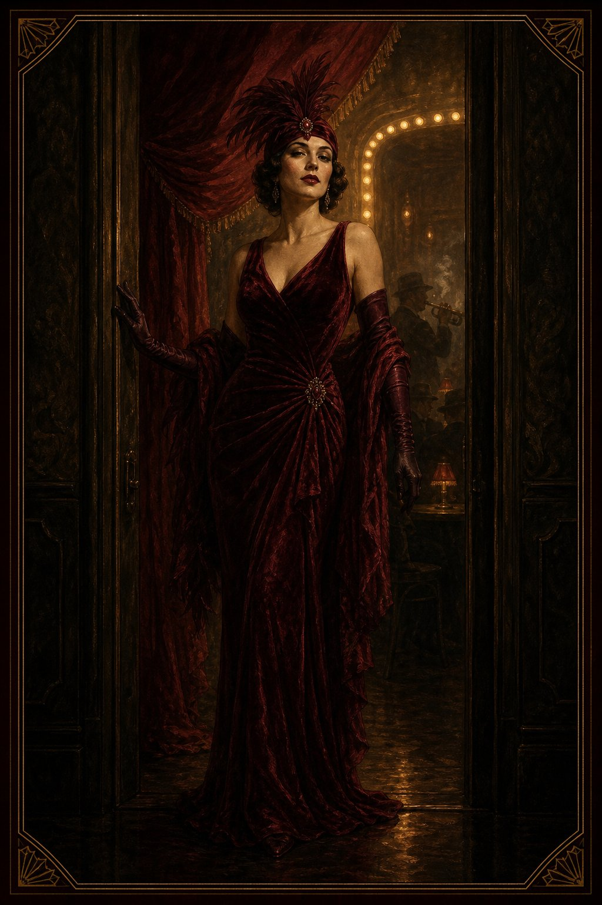

# Мафия: Локация — инструкция для игроков

> **Коротко:** ведущий показывает QR-код, вы сканируете его телефоном,
> вводите имя — и всё. Приложение ставить не нужно, интернет не нужен.
> Роль вы получите на экране, когда начнётся партия.

Карточки в этом документе — те же, что вы увидите в приложении.
Если бумажная версия, их можно распечатать: `assets/instructions/`.

---

## 1. Что нужно, чтобы сесть за стол

| Нужно | Зачем |
|---|---|
| Свой телефон или планшет **с браузером** | Камера — чтобы отсканировать QR. Если камеры нет — введите адрес вручную |
| 6–20 человек | Меньше шести — город не может нормально голосовать |
| Один ведущий | Он не играет: он держит телефон-сервер и объявляет ночь |

> **Интернет не нужен.** Телефон ведущего создаёт свою Wi-Fi-сеть, вы
> подключаетесь к ней. Поэтому в лесу, в поезде и в подвале игра работает.

---

## 2. Как подключиться (30 секунд)

1. Подключите телефон к Wi-Fi, который показывает ведущий
   (название вида `Mafia-1234`).
2. Отсканируйте QR-код с экрана ведущего — откроется страница игры.
   Камера нет — откройте браузер и введите адрес, который ведущий
   назовёт вслух (вида `192.168.43.1:8088`).
3. Введите **имя**. Его увидят все за столом, поэтому лучше настоящее
   или узнаваемое, не «Игрок 7».
4. Дождитесь зелёной надписи «в игре».

**Важно:** имя после входа меняет только ведущий. Если ошиблись —
скажите ему, самому переименоваться нельзя: иначе под одним именем
могли бы играть двое.

**Телефон разрядился или страница закрылась?** Не паникуйте:
1. Снова откройте адрес игры.
2. Введите **то же имя**.
3. Вы вернётесь в свою роль, со своими голосами и трупами. Партия не
   сбросится.

---

## 3. Как идёт партия

### Ночь

Все «спят» — экран показывает, что делать, только тем, у кого есть
ночное дело. Если ваш экран пуст и написано «Спите» — так и должно быть,
это не поломка.

Что происходит ночью по порядку:

1. **Проститутка** выбирает, кого заблокировать. Заблокированный
   пропускает свой ход.
2. **Доктор** выбирает, кого спасти.
3. **Мафия** выбирает жертву. Если мафиози разошлись — решает дон.
4. **Маньяк** выбирает свою жертву — отдельно от мафии.
5. **Комиссар** проверяет одного игрока: мафия или нет.

За одну ночь могут погибнуть **двое**: жертва мафии и жертва маньяка.
Доктор спасает от обоих.

**Ночь знакомства.** Если ведущий включил это правило, в первую ночь
**никто не погибает**: ходит только комиссар, остальные «спят». Мафия
узнаёт своих — они перечислены на вашей карте роли. На экране в это время
написано «Ночь знакомства», и у убийц нет списка целей — так и задумано.
Со второй ночи всё по-настоящему.

**Вверху экрана** всегда видно «Живых: 7 из 10». Нажмите на строку —
откроется список: кто в игре, кто выбыл. Ролей там нет.

**При каждой смене фазы телефон коротко вибрирует** — у всех одинаково,
по вибрации роль не угадать.

### День

Ведущий объявляет, кто погиб. Все обсуждают: кто вёл себя странно,
кто защищал погибшего, кто слишком уверенно знал, что произойдёт.

Это главная часть игры. Ночные роли слабее, чем умение слушать.

### Голосование

Все живые выбирают, кого выгнать из города. Если голоса разделились
поровну между лидерами — второй тур только между ними. Если и там
равенство — никто не выбывает, наступает ночь.

**Воздержаться можно**, но это подарок мафии: ваш голос не достанется
городу.

**Последнее слово.** Изгнанный голосованием получает 30 секунд по
таймеру (если ведущий не выключил это правило). Все слушают, никто не
перебивает. Таймер истёк или ведущий нажал «Слово сказано» — наступает
ночь. Убитым ночью слово не даётся: они не просыпаются.

### Конец партии

| Кто победил | Когда |
|---|---|
| **Город** | Не осталось ни мафии, **ни маньяка** |
| **Мафия** | Мафии стало столько же, сколько горожан (или больше) |
| **Маньяк** | Он остался единственным живым |
| **Ничья** | Не выжил никто — например, мафия и маньяк убили друг друга в одну ночь |

> Обратите внимание: маньяк **не союзник города**. Даже когда мафия
> выбита, партия продолжается, пока жив маньяк.

---

## 4. Роли

Каждая карточка — то, что вы увидите на экране после раздачи.

### 🔫 Мафия

- **Ночью:** вместе с командой выбираете жертву. Видите своих.
- **Днём:** вы такой же горожанин. Лжёте, отводите подозрения,
  голосуете против тех, кто опасен.
- **Победа:** когда мафии станет столько же, сколько горожан.
- **На чём горят:** слишком рьяно защищают союзника; путаются в том,
  кого «убили» прошлой ночью.

### 🎩 Дон

- **Ночью:** решающий голос. Если команда не сошлась — жертва та,
  которую выбрали вы.
- **Днём:** ваш козырь — комиссар видит вас **мирным**. Можно смело
  давить в споре.
- **Победа:** вместе с мафией.
- **Осторожно:** без дона команда теряет решающий голос. Себя берегите.

### 💉 Доктор

- **Ночью:** спасаете одного игрока от мафии **и** от маньяка.
- **Ограничения:** нельзя лечить одного и того же две ночи подряд;
  **себя лечить нельзя**.
- **Победа:** с городом.
- **Тактика:** спасение — сильная улика, но вслух об этом лучше молчать.
  Раскроетесь — следующей ночью вас уберут.

### 🔎 Комиссар

- **Ночью:** проверяете одного игрока — мафия или нет.
- **Где ответ:** после рассвета откройте **«Моя роль»** — там список
  «Ваши проверки» за всю партию. На основном экране ответа нет нарочно:
  сосед не должен увидеть его через плечо. Если ведущий выключил это
  правило, результат он сообщит вам сам.
- **Ловушка:** **дон выглядит мирным**, маньяк — тоже. Ответ «не мафия»
  не значит «свой».
- **Победа:** с городом.
- **Тактика:** раскрыться стоит один раз и в правильный момент —
  с конкретной проверкой, а не «я комиссар, поверьте».

### 💋 Проститутка

- **Ночью:** блокируете игрока — он пропускает свой ход.
- **Сила:** заблокировали мафию — убийства нет.
- **Опасность:** заблокировали доктора или комиссара — помогли мафии,
  сами того не желая.
- **Победа:** с городом.

### 🔪 Маньяк

- **Ночью:** убиваете свою жертву, независимо от мафии.
- **Днём:** играете под горожанина. Вам выгодно, чтобы мафию искали
  не вы.
- **Победа:** **только вы остались живым.** Ни город, ни мафия вам
  не союзники.
- **Тактика:** не добивайте слабейших — вам нужны тела, которые уберут
  мафию за вас.

### 👤 Мирный житель

- **Ночью:** спите. Пустой экран — норма.
- **Днём:** ваше оружие — голос, слух и память. Запоминайте, кто что
  сказал до объявления итогов ночи.
- **Победа:** с городом.

---

## 5. Правила, о которых чаще всего спорят

**«Я же говорил, что я мирный».** Роль не доказывается словами.
Доказательство — только проверка комиссара, и то не всегда (дон).

**«Он первый начал».** Обсуждать можно всё, но выгоняют голосованием.
Крик — не аргумент, а часто признак, что человеку нечего сказать.

**«Меня убили, я больше не играю».** Выбывший не имеет права подсказывать
живым. Даже намёком, даже взглядом. Это ломает партию сильнее любого
читерства: у мёртвого нет причин врать.

**«Я не хочу раскрывать роль».** И не надо. Наоборот: чем меньше
город знает о вашей роли, тем дольше вы живёте.

**«Я не успел нажать».** Таймер идёт от количества активных игроков,
первая ночь длиннее обычной в полтора раза. Если не успеваете —
скажите ведущему заранее, он ставит паузу.

**«А мы так не договаривались».** Правила этого стола — открывают ли
карту выбывшего, есть ли ночь знакомства и последнее слово — записаны
в самой игре: кнопка с книгой («Правила») вверху экрана, она есть
и в лобби, до раздачи ролей. Там же — условия победы и все роли.
Кнопка одинаковая у всех, открывать её можно в любой момент.

---

## 6. Три совета новичку

1. **Молчите первые полминуты обсуждения.** Вы услышите больше, чем
   скажете. Кто заговорил первым и с готовым обвинением — часто мафия.
2. **Записывайте голоса.** Кто против кого голосовал в первом круге —
   самый честный источник информации в игре.
3. **Не бойтесь быть выгнанным.** Выбыть в первой тройке — не позор
   и не ошибка города. Хуже — выбыть молча, не оставив городу ничего.

---

## 7. Если что-то не работает

| Симптом | Что делать |
|---|---|
| Страница не открывается | Проверьте, что вы в Wi-Fi ведущего; обновите страницу |
| «Имя занято» | Кто-то уже играет под этим именем. Выберите другое или позовите ведущего |
| Экран «Подключение…» долго | Ждать: приложение само переподключается без ограничения попыток. Не закрывайте вкладку |
| Вылетело посреди партии | Откройте адрес снова, введите то же имя — вернётесь в свой слот |
| Не видно кнопок ночью | У вас нет ночного действия — это нормально |
