# Мафия: Локация — инструкция для игроков

> **Коротко:** ведущий показывает QR-код, вы сканируете его телефоном,
> вводите имя — и всё. Приложение ставить не нужно, интернет не нужен.
> Роль вы получите на экране, когда начнётся партия.

Карточки в этом документе — те же, что вы увидите в приложении.
Если бумажная версия, их можно распечатать: `assets/instructions/`.

---

## 1. Что нужно, чтобы сесть за стол

| Нужно | Зачем |
|---|---|
| Свой телефон или планшет **с браузером** | Камера — чтобы отсканировать QR. Если камеры нет — введите адрес вручную |
| 6–20 человек | Меньше шести — город не может нормально голосовать. Не хватает людей — ведущий добирает ботов (с 1.11.0) |
| Один ведущий | В обычной партии он не играет: держит телефон-сервер и объявляет ночь. В соло-режиме ведущий играет сам, а остальных заменяют боты |

> **Интернет не нужен.** Телефон ведущего создаёт свою Wi-Fi-сеть, вы
> подключаетесь к ней. Поэтому в лесу, в поезде и в подвале игра работает.

---

## 2. Как подключиться (30 секунд)

1. Подключите телефон к Wi-Fi, который показывает ведущий
   (название вида `Mafia-1234`).
2. Отсканируйте QR-код с экрана ведущего — откроется страница игры.
   Камера нет — откройте браузер и введите адрес, который ведущий
   назовёт вслух (вида `192.168.43.1:8088`).
3. Введите **имя**. Его увидят все за столом, поэтому лучше настоящее
   или узнаваемое, не «Игрок 7».
4. Дождитесь зелёной надписи «в игре».

**Стоит приложение «Мафия» (Android)?** Тогда хватит одного кода:
«Я игрок» → «Сканировать QR» → наведите на первый код ведущего.
Телефон спросит «Сохранить сеть?» — согласитесь. Он сам подключится
к Wi-Fi и войдёт в игру. Не подключился за несколько секунд — на экране
появятся имя сети и пароль: выберите сеть в списке Wi-Fi вручную,
игра найдётся сама.

**Важно:** имя после входа меняет только ведущий. Если ошиблись —
скажите ему, самому переименоваться нельзя: иначе под одним именем
могли бы играть двое.

**Телефон разрядился или страница закрылась?** Не паникуйте:
1. Снова откройте адрес игры.
2. Введите **то же имя**.
3. Вы вернётесь в свою роль, со своими голосами и трупами. Партия не
   сбросится.

---

## 2.1. Если за столом боты (с 1.11.0)

Бот в списке игроков помечен как **«бот»**. Играет он по тем же правилам,
что и человек: получает роль, ходит ночью, голосует днём и иногда говорит.

* **Он не читает чужие роли.** Бот-комиссар знает только свои проверки,
  бот-мафия — только свою команду. Подсмотреть за вас он не может.
* **Он не знает, кто вы.** Если вы молчите весь день, бот голосует
  по своим догадкам, а не по «правильному» ответу.
* **Он не отвечает на речь.** Реплики ботов — это подсказка темпа, а не
  собеседник: услышать ваши обвинения он не может.
* **Ходы ботов приходят через 2–5 секунд.** Если все люди уже сходили,
  ждать нечего — ночь закроется сама.
* В соло-партии день короче (20 секунд): боты не будут ждать вас минуту.
  Ведущий в роли игрока может завершить фазу кнопкой.

---

## 3. Как идёт партия

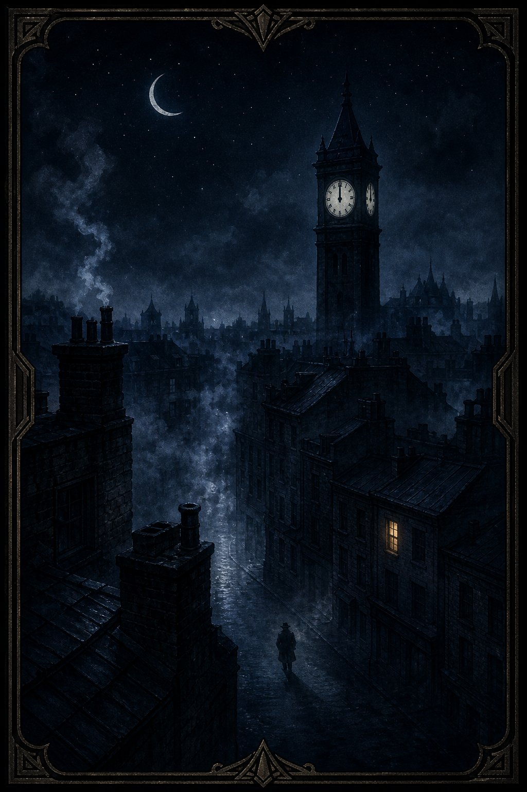

### Ночь

Все «спят» — экран показывает, что делать, только тем, у кого есть
ночное дело. Если ваш экран пуст и написано «Спите» — так и должно быть,
это не поломка.

Что происходит ночью по порядку:

1. **Проститутка** выбирает, кого заблокировать. Заблокированный
   пропускает свой ход.
2. **Шантажист** (с 1.12.0) выбирает горожанина и пугает его: на
   следующий день тот не голосует. Ночной ход жертвы он **не отменяет** —
   это работа проститутки.
3. **Доктор** выбирает, кого спасти.
4. **Телохранитель** (с 1.12.0) выбирает, кого прикрыть собой.
5. **Мафия** выбирает жертву. Если мафиози разошлись — решает дон.
6. **Маньяк** выбирает свою жертву — отдельно от мафии.
7. **Свидетель** (с 1.12.0) выбирает, за кем наблюдать, и узнаёт,
   выходил ли тот из дома.
8. **Охотник** (с 1.12.0) ставит метку на того, кого заберёт с собой.
9. **Комиссар** проверяет одного игрока: мафия или нет.

За одну ночь могут погибнуть **двое**: жертва мафии и жертва маньяка.
Доктор спасает от обоих. Телохранитель принимает удар на себя — погибает
он, а прикрытый выживает (и от двойного удара в одну ночь тоже: щит
держит обоих убийц).

**Ночь знакомства.** Если ведущий включил это правило, в первую ночь
**никто не погибает**: ходит только комиссар, остальные «спят». Мафия
узнаёт своих — они перечислены на вашей карте роли. На экране в это время
написано «Ночь знакомства», и у убийц нет списка целей — так и задумано.
Со второй ночи всё по-настоящему.

**Вверху экрана** всегда видно «Живых: 7 из 10». Нажмите на строку —
откроется список: кто в игре, кто выбыл. Ролей там нет.

**При каждой смене фазы телефон коротко вибрирует** — у всех одинаково,
по вибрации роль не угадать.

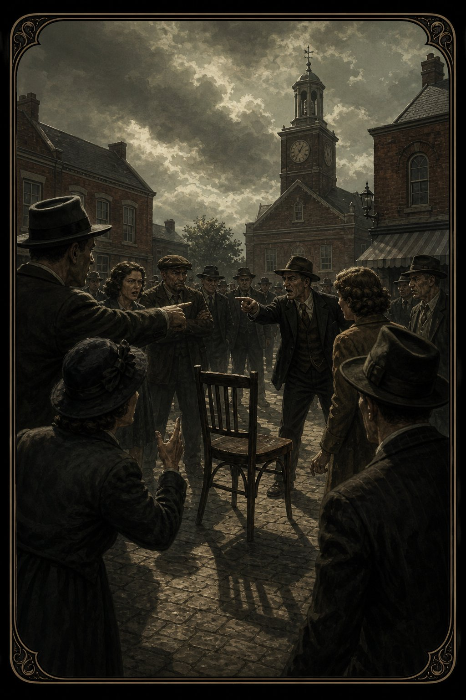

### День

Ведущий объявляет, кто погиб. Все обсуждают: кто вёл себя странно,
кто защищал погибшего, кто слишком уверенно знал, что произойдёт.

Это главная часть игры. Ночные роли слабее, чем умение слушать.

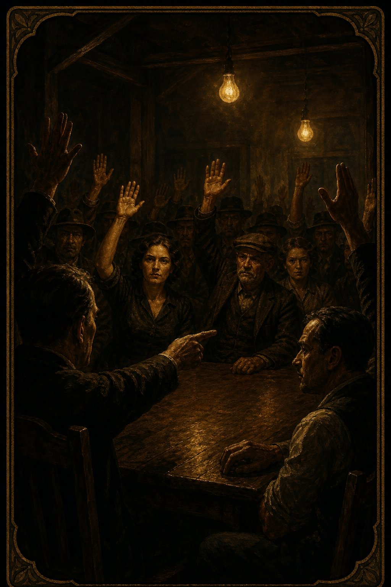

### Голосование

Все живые выбирают, кого выгнать из города. Если голоса разделились
поровну между лидерами — второй тур только между ними. Если и там
равенство — никто не выбывает, наступает ночь.

**Воздержаться можно**, но это подарок мафии: ваш голос не достанется
городу.

**Последнее слово и повторное голосование.** Тот, кого выбрал стол,
**ещё не выбыл**. Порядок такой (если ведущий не выключил это правило):

1. **Последнее слово — 30 секунд по таймеру.** Говорит только он, все
   слушают, никто не перебивает. Это его шанс: объяснить свои ходы,
   назвать подозреваемого, раскрыть роль — что угодно.
2. **Повторное голосование.** У всех живых, кроме него самого, на экране
   две кнопки: **«Выгнать»** и **«Оставить в игре»**.
3. **Подсчёт.** Игрок выбывает, только если «выгнать» **больше**, чем
   «оставить». Поровну — остаётся: сомнение трактуется в его пользу.
   Кто не нажал ничего до конца таймера, не считается ни туда, ни сюда.
4. Убедил стол — **играет дальше**, а в этот день не выбывает никто:
   сразу наступает ночь. Не убедил — выбывает, и тоже ночь.

Второго последнего слова нет. Убитым ночью слово не даётся: они
не просыпаются.

> **Не путайте со вторым туром.** Второй тур — это когда голоса
> разделились поровну между несколькими игроками, и стол выбирает одного
> из них. Повторное голосование — уже про одного человека: выгнать или
> оставить.

Если правило выключено, всё проще и жёстче: кого выбрало голосование,
тот сразу и выбывает.

### Конец партии

| Кто победил | Когда |
|---|---|
| **Город** | Не осталось ни мафии, **ни маньяка** |
| **Мафия** | Мафии стало столько же, сколько горожан (или больше) |
| **Маньяк** | Он остался единственным живым |
| **Ничья** | Не выжил никто — например, мафия и маньяк убили друг друга в одну ночь |

> Обратите внимание: маньяк **не союзник города**. Даже когда мафия
> выбита, партия продолжается, пока жив маньяк.

---

## 4. Роли

Каждая карточка — то, что вы увидите на экране после раздачи.

### 🔫 Мафия

- **Ночью:** вместе с командой выбираете жертву. Видите своих.
- **Днём:** вы такой же горожанин. Лжёте, отводите подозрения,
  голосуете против тех, кто опасен.
- **Победа:** когда мафии станет столько же, сколько горожан.
- **На чём горят:** слишком рьяно защищают союзника; путаются в том,
  кого «убили» прошлой ночью.

### 🎩 Дон

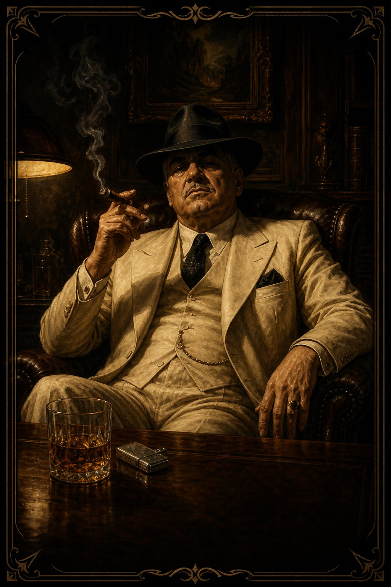

- **Ночью:** решающий голос. Если команда не сошлась — жертва та,
  которую выбрали вы.
- **Днём:** ваш козырь — комиссар видит вас **мирным**. Можно смело
  давить в споре.
- **Победа:** вместе с мафией.
- **Осторожно:** без дона команда теряет решающий голос. Себя берегите.

### 💉 Доктор

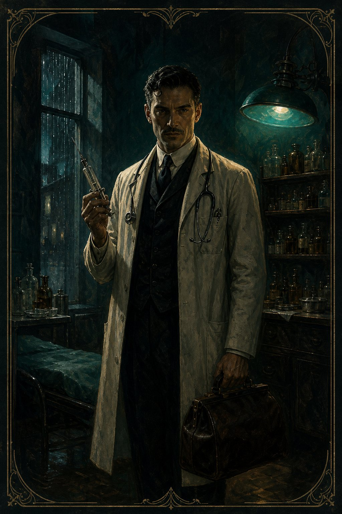

- **Ночью:** спасаете одного игрока от мафии **и** от маньяка.
- **Ограничения:** нельзя лечить одного и того же две ночи подряд;
  **себя лечить нельзя**.
- **Победа:** с городом.
- **Тактика:** спасение — сильная улика, но вслух об этом лучше молчать.
  Раскроетесь — следующей ночью вас уберут.

### 🔎 Комиссар

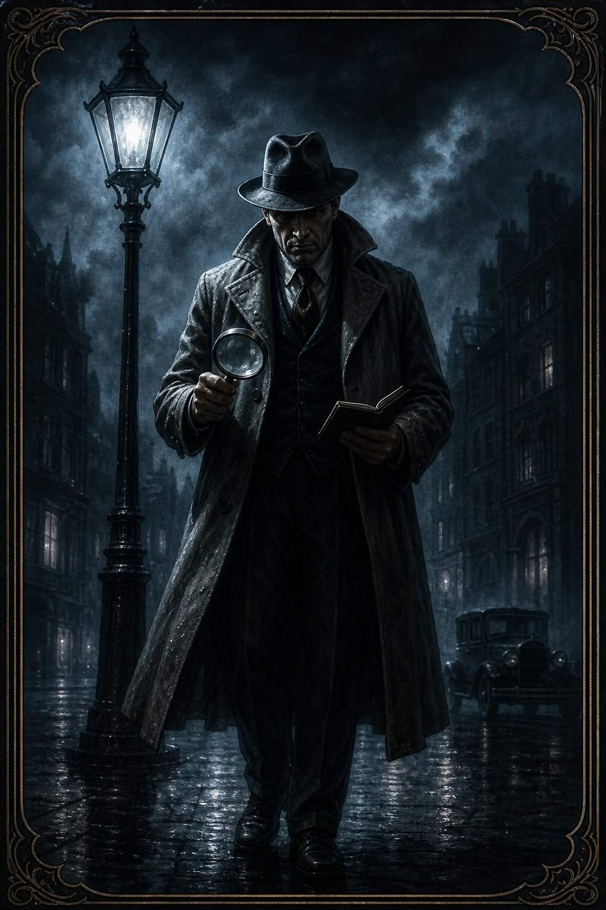

- **Ночью:** проверяете одного игрока — мафия или нет. **Одна проверка
  за ночь:** выбрали — изменить выбор или проверить второго уже нельзя.
- **Где ответ:** **на экране, сразу как выбрали игрока.** Он виден, пока
  идёт ночь, и исчезает с рассветом — чтобы днём сосед не прочёл его
  через плечо. Все проверки за партию хранятся в **«Моя роль»**, в списке
  «Ваши проверки». Если включили маскировку карты, ответ с экрана тоже
  прячется. Если ведущий выключил это правило, результат он сообщит сам.
- **Если ответ пришёл не сразу:** в игре есть проститутка, и она ещё
  не сделала свой ход. Приложение ждёт её: вдруг этой ночью она пришла
  к вам. Ответ появится, как только она выберет, — в любом случае
  до рассвета.
- **«Проверка не состоялась»:** вас заблокировала проститутка. Этой
  ночью вы ничего не узнали; следующая проверка — следующей ночью.
- **Ловушка:** **дон выглядит мирным**, маньяк — тоже. Ответ «не мафия»
  не значит «свой».
- **Победа:** с городом.
- **Тактика:** раскрыться стоит один раз и в правильный момент —
  с конкретной проверкой, а не «я комиссар, поверьте».

### 💋 Проститутка

- **Ночью:** блокируете игрока — он пропускает свой ход.
- **Сила:** заблокировали мафию — убийства нет.
- **Опасность:** заблокировали доктора или комиссара — помогли мафии,
  сами того не желая.
- **Победа:** с городом.

### 🔪 Маньяк

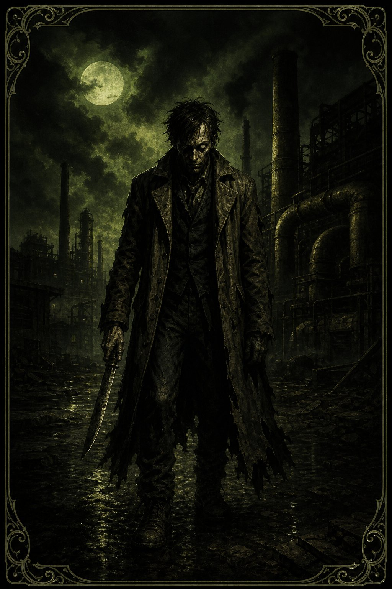

- **Ночью:** убиваете свою жертву, независимо от мафии.
- **Днём:** играете под горожанина. Вам выгодно, чтобы мафию искали
  не вы.
- **Победа:** **только вы остались живым.** Ни город, ни мафия вам
  не союзники.
- **Тактика:** не добивайте слабейших — вам нужны тела, которые уберут
  мафию за вас.

### 🛡 Телохранитель

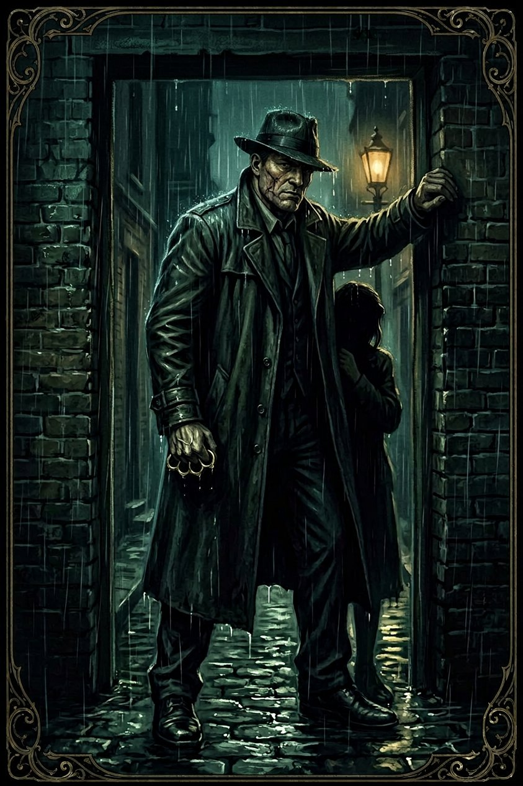

- **Ночью:** прикрываете одного игрока **собой**. Если этой ночью его
  попытаются убить — погибнете вы, а он выживет.
- **Ограничения:** себя прикрывать нельзя, одного и того же — две ночи
  подряд. Щит стоит **раньше** доктора: сначала удар забирает
  телохранитель, и только оставшееся лечит доктор.
- **Если стреляли в вас самого** — щит не спасает: он защищает другого,
  а не вас.
- **Победа:** с городом.
- **Тактика:** прикрывайте того, кому угрожают, — раскрывшегося комиссара
  или игрока, которого стол считает мирным. Ошибка стоит вам жизни,
  поэтому прикрытие — это ставка, а не формальность.

### 👁 Свидетель

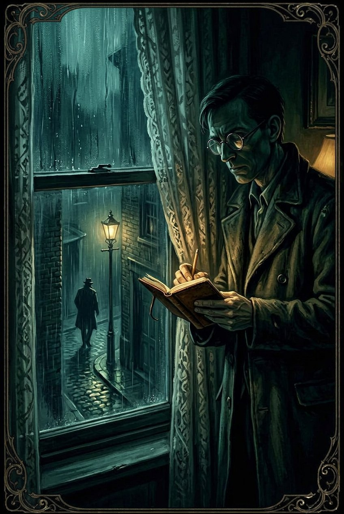

- **Ночью:** выбираете игрока и смотрите, выходил ли он из дома.
- **Где ответ:** только у вас, в «Моя роль», в блоке «Ваше наблюдение».
  Ответ приходит, когда объект сделал свой ход (или ночь закрылась).
- **Что значит «выходил»:** у него был ночной ход — неважно, сработал
  он или его заблокировали. Ночью выходят доктор, комиссар, проститутка,
  телохранитель, мафия и маньяк, поэтому «выходил» — не приговор,
  а факт.
- **Что значит «не выходил»:** он спал. Мирный житель так и живёт,
  а вот мафия и маньяк почти всегда ходят. Это самая сильная улика
  в игре — и её нельзя проверить дважды.
- **Победа:** с городом.
- **Тактика:** не раскрывайтесь ради одной проверки. Факт «он выходил»
  можно сказать вслух, не называя себя: ночью выходит половина стола.

### 🎯 Охотник

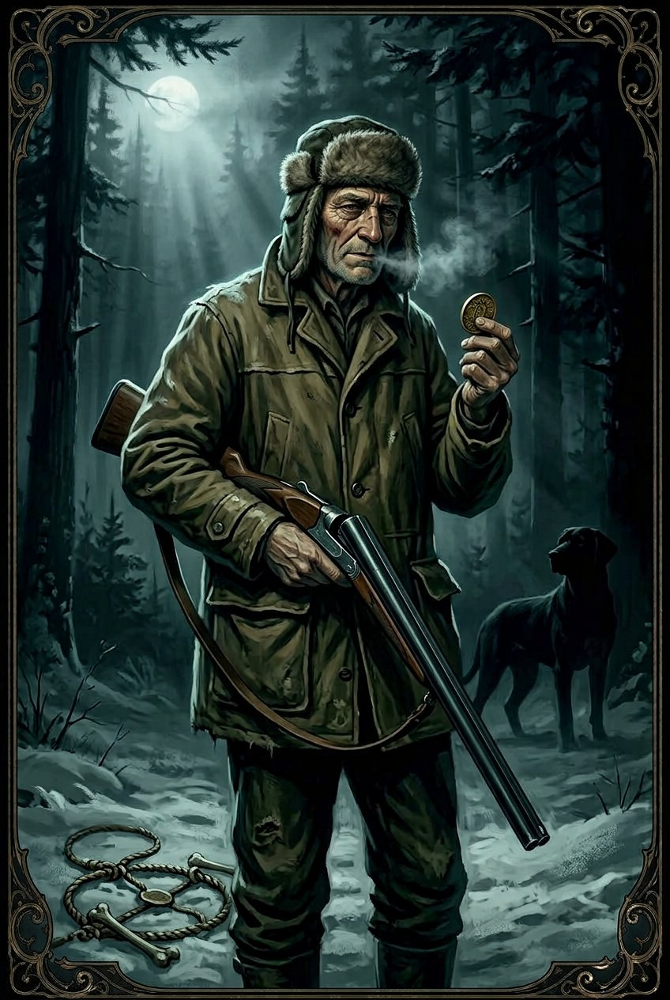

- **Ночью:** ставите метку на одного игрока.
- **Когда срабатывает:** если вас убьют **или выгонят голосованием**,
  отмеченный погибает вместе с вами. Метка действует со **следующей**
  ночи: ту, что вы поставили только что, убийца ещё «не знает».
- **Кого не заберёте:** мёртвого и самого себя. Метку можно менять
  каждую ночь.
- **Победа:** с городом.
- **Тактика:** метьте того, в кого верите меньше всех. Угроза «выгонят
  меня — уйдёт и он» — честный аргумент на голосовании, и стол обязан
  его учитывать.

### 🕶 Шантажист

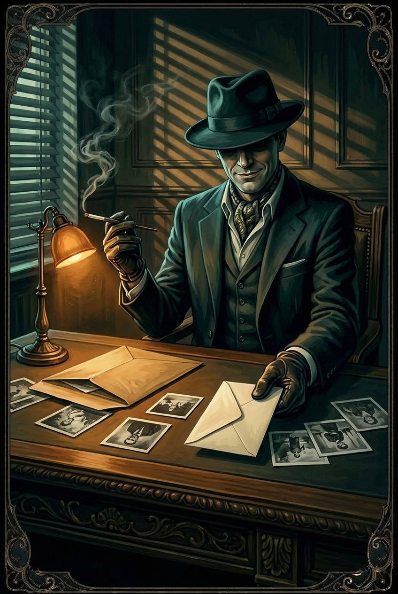

- **Сторона:** мафия. Своих видите на карточке, вас видят они.
- **Ночью:** пугаете одного горожанина — на следующий день он **не
  голосует вообще**. Ход жертвы при этом не отменяется: заблокировать
  доктора вы не можете.
- **Ограничения:** только горожане и только не вы сами. Своего пугать
  бессмысленно — вы бы отняли голос у мафии.
- **Днём:** вы обычный горожанин на вид. Знаете своих, голосуете со всеми.
- **Победа:** вместе с мафией.
- **Тактика:** пугайте того, кто ведёт стол: без его голоса голосование
  может не сложиться. Запуганный вправе сказать всем, что молчит, —
  но «молчун» всё равно останется под подозрением.

### 👤 Мирный житель

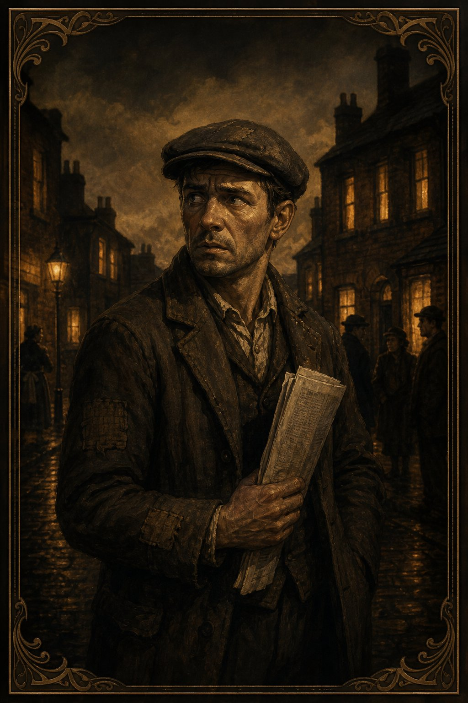

- **Ночью:** спите. Пустой экран — норма.
- **Днём:** ваше оружие — голос, слух и память. Запоминайте, кто что
  сказал до объявления итогов ночи.
- **Победа:** с городом.

> **Сколько ролей в партии.** Набор задаёт ведущий на экране подготовки.
> Рекомендованный состав по размеру стола: до 8 человек — только база,
> 9–12 — добавляется проститутка, 13–16 — шантажист, телохранитель
> и маньяк, 17 и больше — все роли, включая свидетеля и охотника.
> Это подсказка, а не закон: ведущий может поставить любые роли вручную.
> Нет роли за столом — нет и её карточки у вас.

---

## 5. Правила, о которых чаще всего спорят

**«Я же говорил, что я мирный».** Роль не доказывается словами.
Доказательство — только проверка комиссара, и то не всегда (дон).

**«Он первый начал».** Обсуждать можно всё, но выгоняют голосованием.
Крик — не аргумент, а часто признак, что человеку нечего сказать.

**«Меня убили, я больше не играю».** Выбывший не имеет права подсказывать
живым. Даже намёком, даже взглядом. Это ломает партию сильнее любого
читерства: у мёртвого нет причин врать.

**«Я не хочу раскрывать роль».** И не надо. Наоборот: чем меньше
город знает о вашей роли, тем дольше вы живёте.

**«Я не успел нажать».** Таймер идёт от количества активных игроков,
первая ночь длиннее обычной в полтора раза. Если не успеваете —
скажите ведущему заранее, он ставит паузу.

**«А мы так не договаривались».** Правила этого стола — открывают ли
карту выбывшего, есть ли ночь знакомства и последнее слово — записаны
в самой игре: кнопка с книгой («Правила») вверху экрана, она есть
и в лобби, до раздачи ролей. Там же — условия победы и все роли.
Кнопка одинаковая у всех, открывать её можно в любой момент.

---

## 6. Три совета новичку

1. **Молчите первые полминуты обсуждения.** Вы услышите больше, чем
   скажете. Кто заговорил первым и с готовым обвинением — часто мафия.
2. **Записывайте голоса.** Кто против кого голосовал в первом круге —
   самый честный источник информации в игре.
3. **Не бойтесь быть выгнанным.** Выбыть в первой тройке — не позор
   и не ошибка города. Хуже — выбыть молча, не оставив городу ничего.

---

## 7. Если что-то не работает

| Симптом | Что делать |
|---|---|
| Страница не открывается | Проверьте, что вы в Wi-Fi ведущего; обновите страницу |
| «Имя занято» | Кто-то уже играет под этим именем. Выберите другое или позовите ведущего |
| Экран «Подключение…» долго | Ждать: приложение само переподключается без ограничения попыток. Не закрывайте вкладку |
| Вылетело посреди партии | Откройте адрес снова, введите то же имя — вернётесь в свой слот |
| Не видно кнопок ночью | У вас нет ночного действия — это нормально |
